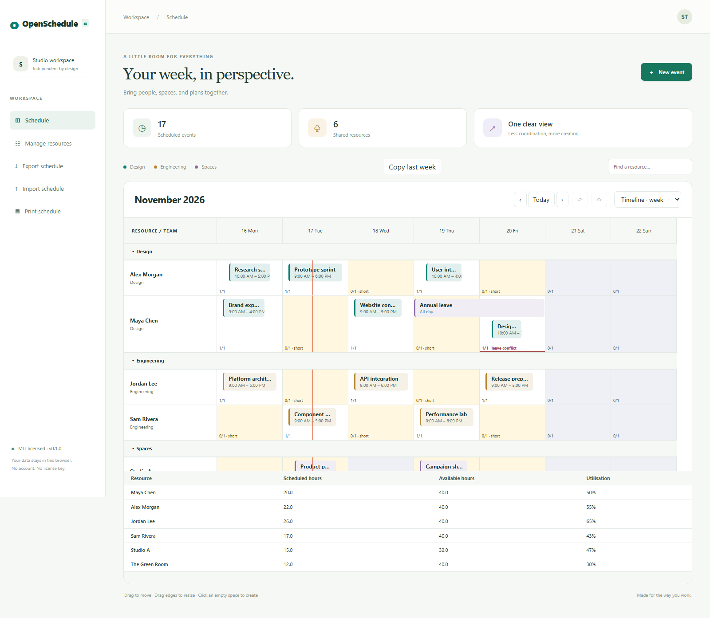

# OpenSchedule

A TypeScript resource scheduler for shift rosters, leave calendars, and interviews. The headless engine has **zero runtime dependencies**. A separate DOM renderer and a working demo are included under the MIT licence.

**Release status: 0.1.0 alpha.** OpenSchedule brings resource planning, scheduling rules, and an accessible roster UI together in a modular library. See [architecture](docs/ARCHITECTURE.md) and [features and release limits](docs/COVERAGE.md).



## Run the demo

Node 20 or newer is needed for development; Node 22 was used for verification.

```sh
npm ci
npm run build
npm run demo
```

Open **http://127.0.0.1:42719**. The demo is served locally and saves its sample schedule in browser localStorage. It includes event and resource editors, JSON import/export, copy-last-week, undo/redo, and printing. Clear the `openschedule-demo-v1` localStorage key to reset sample data. Calendar dates follow the current week.

The package has not been published to npm. Install the supplied `.tgz` into your application, or use the local project path:

```sh
npm install /path/to/openschedule-calendar-0.1.0.tgz
```

## Headless engine

```ts
import { ScheduleStore, timestamp } from "openschedule-calendar/core";

const roster = new ScheduleStore(
  [
    {
      id: "maya",
      title: "Maya Chen",
      group: "Emergency department",
      timeZone: "America/New_York",
      capacity: 1,
      minimumRestHours: 11,
      workingDays: [1, 2, 3, 4, 5],
      holidays: [{ date: "2026-12-25", name: "Branch holiday" }],
      requiredCoverage: 1,
    },
  ],
  [],
  { timeZone: "America/New_York", overlap: false },
);

roster.addEvent({
  id: "night-1",
  title: "Night shift",
  kind: "shift",
  resourceIds: ["maya"],
  start: "2026-11-17T22:00",
  end: "2026-11-18T06:00",
});

const week = {
  start: timestamp("2026-11-16", "America/New_York"),
  end: timestamp("2026-11-23", "America/New_York"),
};

const occurrences = roster.occurrences(week);
const status = roster.cellStatus("maya", week);
const utilisation = roster.utilisation(week);
const unsubscribe = roster.subscribe((change) => console.log(change.kind));

roster.copyWeek("2026-11-16", "2026-11-23"); // atomic; throws on conflict
roster.undo();
unsubscribe();
```

The `/core` entry imports no DOM code or styles and works in Node. Use `packIntervals()` for interval placement in your own renderer. The engine's `getSnapshot()` is referentially stable between mutations and works with React's `useSyncExternalStore`; see [the React example](examples/react.tsx). React is supplied by the consuming application, not installed by this library.

## Optional browser UI

```ts
import { Calendar } from "openschedule-calendar";
import "openschedule-calendar/style.css";
// Define the CSS tokens described in docs/THEMING.md before mounting.

const calendar = new Calendar(document.querySelector("#roster")!, {
  view: "timelineWeek",
  date: "2026-11-16",
  timeZone: "America/New_York",
  resources: roster.resources,
  events: roster.events,
  groupResources: true,
  showCellStatus: true,
  showUtilisation: true,
  dayStart: 0,
  dayEnd: 24,
  slotMinutes: 60,
  snapMinutes: 15,
  editable: true,
  selectable: true,
  onSelect: (selection) => openYourCreateDialog(selection),
  onEventClick: (occurrence) => openYourEditDialog(occurrence),
  onChange: (change) => saveYourSnapshot(change.snapshot),
  onError: (error) => showYourError(error.message),
});

// The UI owns its store. Its state is accessed as calendar.store.
calendar.store.changeOccurrence(occurrences[0], { resourceIds: ["maya"] });
calendar.changeView("timelineDay");
calendar.destroy(); // removes timers, subscriptions, and global listeners
```

The dialog and persistence callbacks above are application code. The included demo provides concrete implementations. The UI does not require you to use its demo editor.

## Roster features

| Requirement                      | Implementation                                                                                      |
| -------------------------------- | --------------------------------------------------------------------------------------------------- |
| People, shifts, or sites as rows | Generic resources with IDs, metadata, parent relationships, capacities                              |
| Day, week, and month timelines   | `timelineDay`, `timelineWeek`, `timelineMonth`; also `timelineYear`                                 |
| Drag/reassign and resize         | Pointer interactions with snapping, start/end handles, keyboard alternatives                        |
| Departments/sites                | Collapsible `group` sections; collapsible parent-child resources                                    |
| Leave and overnight shifts       | Multi-day bars, `kind: 'leave'`, exclusive end times, all-day/timed events                          |
| Employee time zones              | IANA zones, explicit offsets, local/UTC; DST-aware civil arithmetic                                 |
| Branch calendars                 | Per-resource `workingDays` and `holidays`; shaded in the timeline                                   |
| Cell status                      | Coverage count, short staffing, leave conflicts, overlap, insufficient rest                         |
| Accessibility                    | Grid/row/header/cell roles, row/column indices, roving focus, keyboard controls, live announcements |
| Headless architecture            | `/core`, zero runtime dependencies, TypeScript declarations, MIT                                    |
| Weekly rota                      | Daily/weekly recurrence and a strict RRULE subset                                                   |
| Utilisation                      | Scheduled/available/leave hours and percentage, optional summary table                              |
| Copy last week                   | `copyWeek()` with conflict validation and one-step undo                                             |
| Design-system wrapping           | Palette-free component CSS, token contract, React hook example                                      |

Additional views: `resourceDay`, `resourceWeek`, `resourceGrid`, `day`, `week`, `month`, `multiMonth`, and `list`. Timeline resource rows are virtualized. Print rendering expands collapsed and virtualized rows.

## Validation and semantics

- Intervals use **exclusive ends**. Adjacent shifts do not overlap.
- Strings without offsets are interpreted in `event.timeZone`, otherwise the sole resource's zone, otherwise the store zone. Multiple-resource events use the store zone unless explicit. Changing resource assignments preserves absolute instants and the event zone.
- Overnight shifts require the end date to be the following day. Elapsed hours can be 7 or 9 for a nominal 22:00–06:00 shift during DST changes.
- Nonexistent civil input clocks are rejected. Ambiguous fall-back clocks choose the earlier instant; pass an explicit offset to choose the later one. Recurrence skips nonexistent start clocks. General civil-day arithmetic moves a nonexistent result forward.
- Recurring series additions/updates validate occurrences in a configurable `recurrenceValidationDays` horizon: default 366 days, maximum 3660. This is not an infinite reservation guarantee.
- Constructor input, `restore`, feeds, and `transaction` enforce structural validity, not booking policy. This deliberately allows existing problematic rosters to load so `cellStatus()` can report their conflicts. Use `addEvent`, `updateEvent`, and `changeOccurrence` for validated scheduling edits.
- `capacity` is maximum simultaneous events on a resource. `overlap: false` makes it one. Minimum rest applies to non-overlapping shifts; use capacity/overlap rules as well. Leave conflicts are rejected by scheduling edits unless `preventLeaveConflicts: false`.
- Coverage is the **number of shift occurrences intersecting a cell**, excluding leave/background events. A daily cell's `1/2` means one shift booked against a target of two for that day; it does not imply continuous two-person coverage. Use hour cells for finer coverage. No staffing optimiser is included.
- Utilisation sums elapsed scheduled hours. Available hours use business-hour windows, excluding holidays/non-working days. In the absence of business hours, the denominator defaults to 09:00–17:00 on working days (Monday–Friday if none supplied). Leave is reported separately and does not reduce that denominator. Overlapping imports can produce utilisation over 100%.
- Business-hour windows currently stay within a single civil day. For night availability, supply separate windows before and after midnight. Overnight events themselves are supported.
- JSON/function feeds replace the supplied dataset atomically. A newer request or any intervening local edit prevents a pending response from overwriting current state. Cancellation uses `AbortSignal`.

## Test and build

```sh
npm test
npx playwright install chromium
npm run test:browser
npm pack
```

The test suite includes deterministic layout fuzzing, engine invariants, IANA/DST cases, recurring exceptions, constraint checks, feed races, copy rollback, browser interactions, mobile containment, virtualized scrolling, and axe checks for the roster. These checks do not substitute for manual assistive-technology testing or browser-matrix certification.

See [API](docs/API.md), [theme tokens](docs/THEMING.md), [accessibility](docs/ACCESSIBILITY.md), and [coverage](docs/COVERAGE.md).
